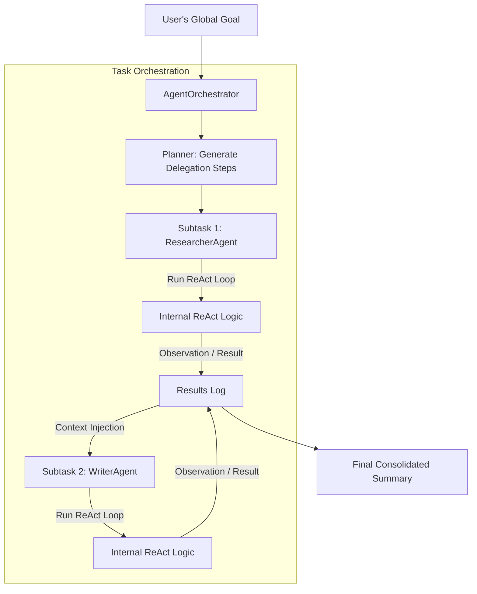

# Orchestra Agents

Modular framework for designing, executing, and orchestrating autonomous multi-agent systems based on the ReAct (Reasoning and Acting) reasoning methodology. The system allows coordinating multiple agents with differentiated specialty roles (researchers, writers, programmers), enabling collaborative resolution of complex goals through structured delegation and dynamic context transfer (Message Passing).

## Multi-Agent Architecture and ReAct Reasoning

The framework is made up of two core abstractions: the execution of each agent's individual logic and the centralized coordination of the working team.



### 1. The ReAct Reasoning Loop (Reasoning + Acting)

Each `AutonomousAgent`-type agent maintains an iterative loop controlled by structured prompts that alternate between reflective analysis steps and practical execution:

1.  **Thought:** The agent reflects on the current task and determines the next logical step or the need to query external data.
2.  **Action:** The agent selects a tool registered in its catalog and invokes it, passing specific arguments:
    $$\text{Output Format:} \quad \text{Action: } \text{tool\_name}(\text{"argument"})$$
3.  **Observation:** The framework intercepts the call, executes the associated Python callback, and returns the textual result to the agent as a new contextual input.

The sequence repeats recursively until the agent determines it has enough information to write the solution, emitting a response in the format `"Final Answer: <answer>"`.

#### ReAct Pattern Parser
The output parser analyzes generations using compiled regular expressions:
*   *Thought filter:* `Thought:\s*(.*?)(?=(?:Action:|Final Answer:|$))` (captures the reasoning scratchpad).
*   *Action filter:* `Action:\s*(\w+)\((.*?)\)` (captures the tool name and its arguments).
*   *Conclusion filter:* `Final Answer:\s*(.*)` (stops the loop and returns the result).

### 2. Orchestration and Message Passing

The `AgentOrchestrator` class acts as a central supervisor that coordinates the decomposition of complex problems.

*   **Task Graph Decomposition:** The global goal is translated into an ordered sequence of subtasks (`TaskDelegation`), where each one defines the assigned agent and the identifiers of the prior tasks it depends on (`dependencies`).
*   **Context Alignment (Message Passing):** When starting a plan step, the orchestrator retrieves the historical log responses corresponding to the declared dependencies. This data is injected into the assigned agent's prompt with supporting tags (`[Task X Result]: ...`), ensuring cognitive continuity.

### 3. Offline Cognitive Simulator

To avoid blocking and network quota consumption during automated tests and CI/CD, the framework includes an offline neural response simulator. It analyzes the task content and the length of the agent's `scratchpad`, emitting artificial traces identical to those a production LLM would generate to guide the agent through the expected call tree.

## Connection to the Ecosystem

This framework serves as the logical control layer for the rest of the workspace:
1.  **nano-vector-db / hybrid-search-retrieval-pipeline:** Registered as tools in the agent's catalog (e.g. `search_db`), allowing the `ResearcherAgent` to dynamically retrieve indexed documents.
2.  **llm-inference-server:** If the simulator is disabled (`use_mock_llm=False`), the agent's ReAct loop requests are routed via REST calls to the local inference server.
3.  **secure-tool-runtime:** Complex tools involving script execution on disk or system commands are routed to the isolated environment (Sandbox) to protect the operating system's integrity.

## Project Structure

*   `agent.py`: `AutonomousAgent` class implementing the ReAct loop, the control-expression parser, and the local cognitive simulator.
*   `orchestrator.py`: `AgentOrchestrator` class and the `TaskDelegation` data schema for managing multi-agent collaboration plans.
*   `test_agents.py`: Integration tests verifying plan decomposition, context dependency injection, and prevention of infinite loops in the ReAct cycle.
*   `example.py`: Interactive demo running a team made up of a researcher and a writer, generating a final report in Markdown.

## Using it as a package

Since `0.1.0` the code lives in the `orchestra_agents` package and the repository is
pip-installable, so other projects can depend on it instead of copying files
or editing `sys.path`:

```bash
pip install "orchestra-agents @ git+https://github.com/juanmmm21/orchestra-agents.git@v0.1.0"
```

```python
from orchestra_agents import AutonomousAgent
```

The old top-level modules are kept as thin re-exports, so scripts that add
this folder to `sys.path` keep working. This component imports no other
ai-core component: they are combined in the `aicore` SDK of
[ai-core-infra-hub](https://github.com/juanmmm21/ai-core-infra-hub), which
passes collaborators (vector stores, encoders, tokenizers) in by injection.

Development: `pip install -e ".[dev]"`, then `pytest` and `ruff check .`.

## Installation and Execution

### 1. Set Up the Environment and Install Dependencies

Activate the subproject's virtual environment:

```bash
python3 -m venv .venv
source .venv/bin/activate
pip install -r requirements.txt
```

### 2. Run Automated Tests

Validate the logical dependencies and agent sequencing:

```bash
.venv/bin/python -m unittest test_agents.py
```

### 3. Run the Multi-Agent Demo

Start the script to watch real-time collaboration between specialized agents:

```bash
.venv/bin/python example.py
```

The script will print to the console the full log of thoughts, vector tool invocations, and the final report consolidated by the writer agent.
